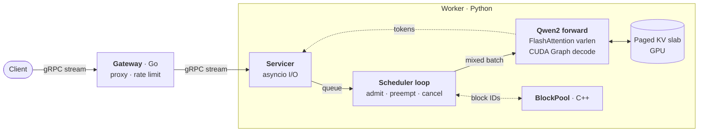
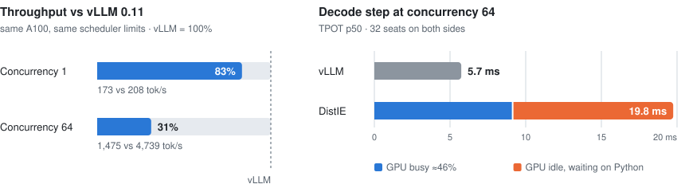

# DistIE

An LLM inference server built from scratch, with every stage measured and the last one benchmarked against vLLM.

**Go** gRPC gateway · **Python** GPU worker with continuous batching over a paged KV cache · in-house **Qwen2** forward with FlashAttention and CUDA Graphs · **C++** KV block allocator

| | |
|---|---|
| **Correct** | Token-for-token match with HuggingFace greedy decoding (fp32 and fp16). Batched output is identical to one-at-a-time output. |
| **24× throughput** | Continuous batching takes 40.8 → 978.9 output tok/s on an RTX 3080 Laptop. |
| **83% of vLLM** | Same A100, same scheduler limits. 31% at concurrency 64, with the gap [traced to per-step CPU overhead](#where-the-gap-comes-from). |

<sub>Qwen2.5-1.5B-Instruct fp16 · 200 ShareGPT conversations sent at once · up to 256 output tokens each</sub>

## Architecture



- **Gateway** forwards token streams and rejects excess load with a leaky bucket.
- **Servicer** only does I/O. Requests reach the scheduler through a queue, and a cancelled client frees its KV blocks.
- **Scheduler loop** owns the GPU. Each step it admits requests by KV block budget, preempts by recompute when blocks run out, and runs one mixed prefill/decode batch.
- **Qwen2 forward** reads and writes the paged KV slab directly, with no per-step gather or scatter.
- **BlockPool** (C++) tracks block IDs only. The KV tensors stay in a torch-allocated slab.

## Results

<picture>
  <source media="(prefers-color-scheme: dark)" srcset="docs/img/vs-vllm-dark.svg">
  
</picture>

### Where the gap comes from

Batched decode is **CPU-bound**. In the measured version, batch-1 decode was captured as a CUDA Graph but batched decode was not. Each step, Python launched every layer's kernels and built `cu_seqlens`, `slot_mapping` and block tables, which cost about 14 ms per step. Three measurements point to it:

- **The GPU idles about half the time.** SM utilization holds at 45–47% during decode at concurrency 64.
- **Batch size barely matters.** Doubling the seats from 32 to 64 adds only 8% to TPOT.
- **A faster GPU barely helps.** Moving from the 3080 to the A100 cut batch-1 TPOT from 13.2 to 5.7 ms, but batched TPOT only went from 29.7 to 19.8 ms.

Stage 4.5 now replays batched decode from bucketed CUDA Graphs as well. On the 3080 at concurrency 64 this raised throughput from 956 to 1271 tok/s (+33%) and cut TPOT p50 from 29.8 to 22.7 ms ([report](benchmarks/results/stage4.5-3080.md)). A100 numbers are pending.

### Stage by stage (RTX 3080 Laptop)

| Stage | What changed | Concurrency | Output tok/s | TPOT p50 |
|---|---|---:|---:|---:|
| 2 | HF forward, KV gathered and scattered every step | 1 | 40.8 | 23.7 ms |
| 3 | In-house Qwen2, FlashAttention, CUDA Graph decode | 1 | 75.1 | 13.2 ms |
| 4 | Continuous batching, varlen batched forward | 64 | **978.9** | 29.7 ms |

<details>
<summary><b>Full vLLM comparison</b> (A100-SXM4-80GB)</summary>

| Run | Concurrency | Output tok/s | TTFT p50 | TPOT p50 |
|---|---:|---:|---:|---:|
| vLLM 0.11, aligned | 1 | 207.7 | 18.7 ms | 4.72 ms |
| **DistIE** | 1 | **173.2** | 19.0 ms | 5.68 ms |
| vLLM 0.11, aligned | 64 | 4739.2 | 1.04 s | 5.74 ms |
| **DistIE** | 64 | **1475.4** | 3.40 s | 19.75 ms |
| DistIE, 64 seats | 64 | 2382.8 | 44.8 ms | 21.38 ms |
| vLLM 0.11, defaults | 64 | 6751.2 | 110 ms | 6.79 ms |

"Aligned" gives vLLM the same limits as DistIE: 32 seats, a 2048-token step budget, the same KV capacity, prefix caching off and no repetition penalty. Total output tokens agree within 0.2% across all runs, so throughput compares like with like. High TTFT at concurrency 64 is queueing for a seat, not slow prefill.

</details>

Reports: [stage 3](benchmarks/results/stage3-3080.md) · [stage 4](benchmarks/results/stage4-3080.md) · [A100 vs vLLM](benchmarks/results/stage4-a100-vs-vllm.md) (in Chinese) · raw JSON in [`benchmarks/results/`](benchmarks/results/)

## Quickstart

Needs Linux or WSL2 with an NVIDIA GPU, [uv](https://docs.astral.sh/uv/), CMake ≥ 3.18 with a C++17 compiler, and Go.

```bash
make setup && make core && make gateway
.venv/bin/pip install flash-attn==2.8.3 --no-build-isolation   # match your torch/CUDA build

# worker on :50052, gateway on :50051
PYTHONPATH=worker/src DISTIE_ATTN=flash WORKER_NUM_BLOCKS=512 .venv/bin/python -m worker.main
DISTIE_WORKER_ADDR=localhost:50052 ./bin/gateway

# both servers have gRPC reflection enabled
grpcurl -plaintext -d '{"prompt": "Explain paged attention in one sentence.", "params": {"max_tokens": 64}}' \
  localhost:50051 distie.inference.v1.InferenceService/InferStream
```

```bash
make test                       # Go, worker and benchmark unit tests
make correctness DTYPE=fp16     # token parity against HF greedy decoding
make sharegpt && make bench     # load test the worker (BACKEND=openai TARGET=... for vLLM)
```

<details>
<summary><b>Configuration</b></summary>

| Variable | Default | Meaning |
|---|---|---|
| `DISTIE_ATTN` | `torch` | Worker attention: `torch` (exact fp32 checks) or `flash` |
| `WORKER_NUM_BLOCKS` | `1024` | KV pages (256 tokens each with `flash`) |
| `WORKER_MAX_SEQS` | `32` | Sequences running at once |
| `WORKER_TOKEN_BUDGET` | `2048` | Tokens per scheduler step |
| `WORKER_DECODE_GRAPHS` | `1` | Replay pure-decode steps from CUDA graphs (needs CUDA and `flash`) |
| `WORKER_STEP_STATS` | `0` | Every N steps, log where step time goes: schedule, GPU, event-loop wait, emit (0 = off) |
| `WORKER_MODEL` | `Qwen/Qwen2.5-1.5B-Instruct` | HuggingFace model ID |
| `WORKER_DEVICE` | `cuda` | `cuda` or `cpu` |
| `WORKER_LISTEN_ADDR` | `:50052` | Worker listen address |
| `DISTIE_LISTEN_ADDR` | `:50051` | Gateway listen address |
| `DISTIE_WORKER_ADDR` | — | Upstream worker; requests fail with `Unavailable` if unset |
| `DISTIE_RATE_LIMIT_RPS` | `20` | Gateway leaky-bucket rate (0 disables it) |
| `DISTIE_RATE_LIMIT_BURST` | `40` | Bucket capacity |

If `torch` resolves to a CPU build, install it from the CUDA wheel index (see `worker/requirements.txt`).

</details>

## Layout

```
gateway/     Go gateway: gRPC server, upstream client, rate limiter
worker/      Python worker: servicer, scheduler, Qwen2 model, paged attention
core/        C++ BlockPool + pybind11 bindings
proto/       inference.proto and generated code
benchmarks/  HF parity, decode latency, load generator, results/
```

## Roadmap

- [x] **0–1** Go gateway with streaming and rate limiting · C++ block allocator
- [x] **2** Correctness suite and baseline
- [x] **3** In-house Qwen2 forward, paged FlashAttention, CUDA Graph decode
- [x] **4** Continuous batching and the vLLM comparison
- [x] **4.5** CUDA Graphs for batched decode, bucketed by batch size: +33% throughput on the 3080 (A100 re-measurement pending)
- [ ] **Next** Per-step metadata out of Python · seats sized from KV capacity
- [ ] **5** C++ KV block manager: refcounts, prefix caching, LRU eviction, copy-on-write, CPU swap
- [ ] **6** Prefix-aware routing across workers
- [ ] **7** Observability

Design and revision history: [`proposal.md`](proposal.md) · daily notes: [`devlog.md`](devlog.md)
