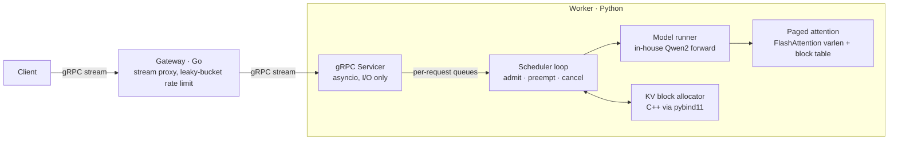

# DistIE

**An LLM inference server built from scratch.** It has a Go gRPC gateway, Python GPU workers with continuous batching over a paged KV cache, an in-house Qwen2 forward pass using FlashAttention and CUDA Graphs, and a C++ KV block allocator.

The project aims to measure every stage and explain where the remaining gap to vLLM comes from.

| | Result |
|---|---|
| Correctness | Token-for-token match with HuggingFace greedy decoding (8/8 prompts, fp32 and fp16); concurrent batched output identical to one-at-a-time |
| Continuous batching | **24×** output throughput over the serial baseline (40.8 → 978.9 tok/s, RTX 3080 Laptop) |
| vs. vLLM 0.11, same A100 and config | **83%** of vLLM's throughput at concurrency 1; 31% at concurrency 64, with the gap traced to per-step CPU overhead (see [Analysis](#where-the-gap-to-vllm-comes-from)) |

Model: Qwen2.5-1.5B-Instruct (fp16). Workload: 200 ShareGPT conversations, all sent at once, capped at 256 output tokens.

---

## Architecture



- **Gateway (Go)** accepts client streams, enforces a leaky-bucket rate limit (returns `ResourceExhausted` when exceeded), and forwards the token stream from a worker.
- **Worker servicer** only handles I/O. It puts each request on the scheduler's waiting queue and streams tokens back from a per-request queue. Client cancellation frees the request's KV blocks.
- **Scheduler loop** owns the GPU. Each step it admits waiting requests by KV block budget, preempts by recompute when blocks run out, and builds one mixed prefill/decode batch under a per-step token budget.
- **Model runner** is a Qwen2 implementation that loads HuggingFace weights. Attention reads and writes a preallocated paged KV slab directly, so no dense cache is gathered or scattered per step. Batch-1 decode is captured as a CUDA Graph.
- **C++ core** (`BlockPool`) tracks KV block IDs. The K/V tensors stay in a torch-allocated GPU slab, so C++ handles metadata only.

## Results

All raw JSON is in [`benchmarks/results/`](benchmarks/results/).

### Stage by stage (RTX 3080 Laptop 16 GB, WSL2)

| Run | Engine | Concurrency | Output tok/s | TPOT p50 |
|---|---|---:|---:|---:|
| Stage 2 baseline | HF forward, paged KV gathered/scattered per step, one request at a time | 1 | 40.8 | 23.7 ms |
| Stage 4, serial | Stage 3's in-house Qwen2 + FlashAttention + CUDA Graph decode | 1 | 75.1 | 13.2 ms |
| Stage 4, batched | Plus the continuous-batching scheduler and varlen batched forward | 64 | **978.9** | 29.7 ms |

The serial gain comes from stage 3: in an isolated batch-1 test, its decode path has a TPOT of 12.2 ms, compared with 18.1 ms for HF `generate` ([stage 3 report](benchmarks/results/stage3-3080.md)). The batched gain comes from stage 4 ([stage 4 report](benchmarks/results/stage4-3080.md)).

### Against vLLM (A100-SXM4-80GB, same machine and load generator)

| Run | Concurrency | Output tok/s | TTFT p50 | TPOT p50 |
|---|---:|---:|---:|---:|
| vLLM 0.11, aligned config | 1 | 207.7 | 18.7 ms | 4.72 ms |
| **DistIE** | 1 | **173.2** | 19.0 ms | 5.68 ms |
| vLLM 0.11, aligned config | 64 | 4739.2 | 1.04 s | 5.74 ms |
| **DistIE** | 64 | **1475.4** | 3.40 s | 19.75 ms |
| DistIE, 64 seats | 64 | 2382.8 | 44.8 ms | 21.38 ms |
| vLLM 0.11, default config | 64 | 6751.2 | 110 ms | 6.79 ms |

In the "aligned" runs, vLLM uses the same limits as DistIE: 32 concurrent sequences, a 2048-token step budget, the same KV capacity, prefix caching off, and no repetition penalty. Across all six runs, total output tokens agree to within 0.2%. Full setup and reproduction steps are in the [A100 report](benchmarks/results/stage4-a100-vs-vllm.md) (in Chinese).

### Where the gap to vLLM comes from

Batched decode is **CPU-bound**:

- **TPOT grows with batch size.** From concurrency 1 to 64, vLLM's TPOT goes from 4.7 to 5.7 ms; DistIE's goes from 5.7 to 19.8 ms.
- **A faster GPU barely helps the batched path.** Moving from the 3080 to the A100 cut batch-1 TPOT from 13.2 to 5.7 ms, but batched TPOT only went from 29.7 to 19.8 ms.
- **The GPU waits about half the time.** During decode at concurrency 64, SM utilization holds at 45–47%.
- **The cost is a fixed per-step overhead.** Doubling the seats from 32 to 64 raises TPOT by only 8%.

The extra ~14 ms per step comes from launching each layer's kernels from Python (batched decode is not yet graph-captured) and from building `cu_seqlens`, `slot_mapping`, and block tables in Python each step. Those are the next things to fix (see [Roadmap](#roadmap)).

## Quickstart

Requirements: Linux or WSL2 with an NVIDIA GPU, [uv](https://docs.astral.sh/uv/), CMake ≥ 3.18 with a C++17 compiler, and Go (needed for the gateway and for regenerating protos).

```bash
make setup            # .venv (Python 3.12) + worker deps + protoc Go plugins
make core             # build the C++ BlockPool and pybind11 module, run its tests
make gateway          # build bin/gateway

# FlashAttention is not in requirements.txt; install a build matching your torch/CUDA
.venv/bin/pip install flash-attn==2.8.3 --no-build-isolation
```

If `torch` resolves to a CPU build, install it from the CUDA wheel index (see `worker/requirements.txt`).

Run a worker and the gateway:

```bash
# Worker on :50052
PYTHONPATH=worker/src DISTIE_ATTN=flash WORKER_NUM_BLOCKS=512 .venv/bin/python -m worker.main

# Gateway on :50051, forwarding to the worker
DISTIE_WORKER_ADDR=localhost:50052 ./bin/gateway
```

Both servers enable gRPC reflection, so you can call them with [grpcurl](https://github.com/fullstorydev/grpcurl):

```bash
grpcurl -plaintext -d '{"prompt": "Explain paged attention in one sentence.", "params": {"max_tokens": 64}}' \
  localhost:50051 distie.inference.v1.InferenceService/InferStream
```

Correctness and benchmarks:

```bash
make test                                   # Go, worker, and benchmark unit tests
make correctness DTYPE=fp16                 # token parity against HF greedy decoding
make sharegpt                               # download the ShareGPT dataset
make bench MAX_CONCURRENCY=64               # load test against the worker on :50052
make bench BACKEND=openai TARGET=http://localhost:8000   # same load against a vLLM server
```

## Configuration

| Variable | Default | Component | Meaning |
|---|---|---|---|
| `DISTIE_ATTN` | `torch` | worker | Attention backend: `torch` (indexing, for exact fp32 checks) or `flash` |
| `WORKER_NUM_BLOCKS` | `1024` | worker | KV pages in the slab (256 tokens per page with `flash`) |
| `WORKER_MAX_SEQS` | `32` | worker | Maximum sequences running at once |
| `WORKER_TOKEN_BUDGET` | `2048` | worker | Maximum tokens per scheduler step |
| `WORKER_MODEL` | `Qwen/Qwen2.5-1.5B-Instruct` | worker | HuggingFace model ID |
| `WORKER_DEVICE` | `cuda` | worker | `cuda` or `cpu` |
| `WORKER_LISTEN_ADDR` | `:50052` | worker | gRPC listen address |
| `DISTIE_LISTEN_ADDR` | `:50051` | gateway | gRPC listen address |
| `DISTIE_WORKER_ADDR` | *(unset)* | gateway | Upstream worker; requests fail with `Unavailable` if unset |
| `DISTIE_RATE_LIMIT_RPS` | `20` | gateway | Leaky-bucket rate (0 disables it) |
| `DISTIE_RATE_LIMIT_BURST` | `40` | gateway | Bucket capacity |

## Repository layout

```
gateway/      Go gateway: config, gRPC server, upstream client, rate limiter
worker/       Python worker: gRPC servicer, scheduler, Qwen2 model, paged attention, KV cache
core/         C++ BlockPool + pybind11 bindings, with C++ and Python tests
proto/        inference.proto and generated Go code
benchmarks/   correctness checks (HF parity, decode latency) and the load generator; results/
scripts/      dev setup, proto generation, C++ build
```

## Roadmap

- [x] **Stage 0** — Go gateway, gRPC streaming, rate limiting
- [x] **Stage 1** — C++ block allocator, paged KV prototype
- [x] **Stage 2** — Correctness suite and measurement baseline
- [x] **Stage 3** — In-house Qwen2 forward, paged FlashAttention, CUDA Graph decode
- [x] **Stage 4** — Continuous batching and the vLLM comparison
- [ ] **Next** — CUDA Graphs for batched decode (bucketed by batch size); move per-step metadata assembly out of Python; size seats from KV capacity
- [ ] **Stage 5** — C++ KV block manager: reference counting, prefix caching, LRU eviction, copy-on-write, CPU swap
- [ ] **Stage 6** — Prefix-aware routing across multiple workers
- [ ] **Stage 7** — Observability

The full design and its revision history are in [`proposal.md`](proposal.md) (Chinese, with an English version below it). Day-to-day notes are in [`devlog.md`](devlog.md).
